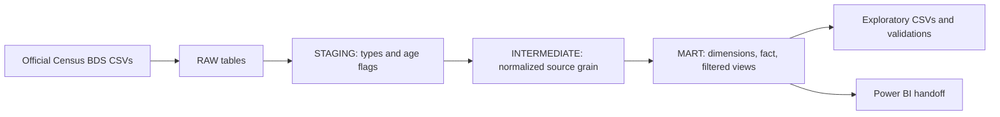
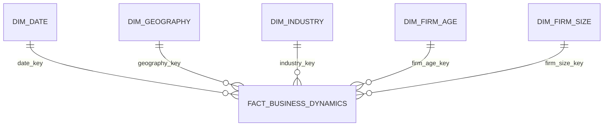

# American Business Lifecycle
Describe where U.S. employment grows and contracts across states, industries, firm ages, and firm sizes using Census BDS data.

## Executive summary

- In 2023, U.S. firms recorded 18.45M jobs created, 15.01M destroyed, and +3.44M net change.
- California added the most jobs in 1978–2023 (+8.54M); Nevada had the largest percentage increase (+362.54%).
- Health care and accommodation/food added 1.67M jobs combined in 2023 (48.6% of national net change).
- Pre-shock BDS years 2015–2020 added +12.83M net (+2.14M annual average); the 2021 shock year lost 5.52M; 2022–2023 added +10.52M (+5.26M annual average).
- Treating left-censored firms as unknown-age/mature by a documented year rule reverses the 2023 mature-group result from −54,435 to +964,232 net jobs.
- Health care/social assistance and accommodation/food added 1.67M jobs in 2023; California led long-run state job additions (+8.54M), while Nevada led percentage growth (+362.54%). These are descriptive rankings, not causal explanations.

## Dashboard status

The five-page Power BI dashboard is specified but not built: this repository contains no `.pbix`, and Power BI Desktop validation against DuckDB was unavailable in this macOS environment. See the [Power BI handoff](powerbi/README.md) for its model, filtered views, and DAX.

## Findings by business question

1. **Where is employment growing?** Nevada led percentage growth from 1978–2023 (+362.54%); California led absolute job additions (+8,544,842). In 2023, Delaware led the BDS net job creation rate (6.794%), while Texas added the most jobs (+448,722). **Stakeholder action:** distinguish market growth rates from addressable job volume when prioritizing states.
2. **Where is employment contracting?** In 2008–2010 California lost the most jobs (−1,377,566), while Nevada had the worst weighted annual rate (−5.916%). In the 2021 shock window California again led absolute losses (−844,599), while Hawaii had the worst rate (−15.327%; denominator 509,233). **Stakeholder action:** use both volume and rate rankings, and flag small-base rates as volatile. `make all` generates period-level outputs under `data/processed/` from [the analysis script](analysis/exploratory_analysis.py).
3. **Which industries drive growth?** Health care and social assistance added 881,400 jobs (25.6% of national net change) in 2023; accommodation and food added 791,588 (23.0%). **Stakeholder action:** prioritize these sectors for follow-up, without treating contribution as a causal explanation.
4. **Which industries contract?** Administrative/support/waste management declined by 130,391 jobs in 2023; information and agriculture declined by 8,797 and 5,816. **Stakeholder action:** focus review on the largest decline, then inspect detailed subsectors before acting.
5. **How do young and mature firms differ?** Young firms (0–5 years) added 2,484,030 net jobs in 2023. Known-age mature firms (6+) lost 54,435, but the mature-extended rollup including left-censored firms gained 964,232. The groups' net sum differs from national net change by 8,923 due to Census noise. **Stakeholder action:** use the extended mature view for composition-aware comparisons and keep unknown ages visible.
6. **How do size bands differ?** Firms with 20–99 employees added 701,903 net jobs in 2023, slightly more than firms with 10,000+ (690,312), despite the latter's larger employment stock (41.1M versus 22.1M). **Stakeholder action:** compare both rate and job volume and account for size-band reclassification.
7. **How did dynamics change around COVID-19?** BDS year *t* measures March-to-March change: 2020 ended in March 2020 and was pre-shock (+835,961; +0.632%); 2021 captured the shock (−5,518,197; −4.245%). Mean annual rates were 1.693% in 2015–2020 and 3.979% in 2022–2023; net-flow totals and annual averages are reported together because windows differ. **Stakeholder action:** monitor the rebound against longer trends; the descriptive series does not establish a COVID or policy effect.

Full metric/comparison/interpretation/limitation detail is in [docs/findings.md](docs/findings.md).

## Data confidence

The source is the U.S. Census Bureau [Business Dynamics Statistics](https://www.census.gov/programs-surveys/bds/data.Datasets.html), 2023 release (source release date 2025-09-25). Five official CSVs were downloaded/validated on 2026-10-29 local time. Expected SHA-256 hashes and file-level metadata are pinned in [`ingestion/ingest_bds.py`](ingestion/ingest_bds.py) and recorded in [`data/raw/bds/ingestion_log.json`](data/raw/bds/ingestion_log.json). The raw files are about 700 KB and remain in the repository so builds can run offline; the Census data are public and are attributed to the Bureau.

Tests reconcile national employment exactly to the state margin and compare sector, age, and size margins with documented Census-noise tolerances. A separate plausibility check compares national BDS flows with BLS Business Employment Dynamics (BED), which uses a different source, coverage, and production method and publishes rounded thousands. In 2023, BDS versus BED was 18,450,927 vs. 16,008,000 job creations, 15,011,588 vs. 12,669,000 destructions, and 3,439,339 vs. 3,339,000 net change. Across 2021–2023, BDS net change was close to BED: relative differences were −0.72%, +2.24%, and +3.01% of absolute BED net, while gross flows differed more. This is an independent plausibility comparison, not a like-for-like validation; see [docs/data_quality.md](docs/data_quality.md). `make all` generates the detailed comparison CSV under `data/processed/` from [the comparison script](analysis/compare_bds_bed.py).

## Design decisions and trade-offs

- **One-way BDS tables, not a full cube:** the source publishes separate national, state, industry, age, and size margins. Their intersections are unavailable here; joining them as if they formed a cube would imply unsupported detail. The shared fact preserves the source grain, while Power BI receives one filtered view per margin.
- **DuckDB:** one local, file-based SQL engine keeps ingestion, transformations, analytical views, and tests reproducible without a database server. A server warehouse would add deployment overhead outside this compact project.
- **COVID windows:** BDS year *t* compares March 12 employment in *t−1* and *t*. Thus, 2015–2020 is pre-shock, 2021 is the shock window, and 2022–2023 is the rebound. The windows differ in length; totals are shown with annual averages and are not annualized. The state recession window begins in 2008 because BDS year 2007 ends in March 2007.
- **BDS net job creation rate:** use the published rate and denominator as the consistent annual growth proxy available in the selected tables. It is not an employment-stock CAGR and does not support causal claims.
- **Left-censored age:** the Census describes these firms as born before 1977 with unknown exact age. We retain them separately before 1982; from 1982 their minimum possible age is six. The mature-extended category is a rollup and must not be added to its component rows. See the official [FAQ](https://www.census.gov/programs-surveys/bds/about/faq.html) and [glossary](https://www.census.gov/content/dam/Census/programs-surveys/business-dynamics-statistics/codebook-glossary.pdf).

## Architecture





The fact grain is year × one published observation category. Because it unions five independent margins, an unfiltered employment sum counts the national stock five times; use the margin-specific Power BI views. See [docs/data_dictionary.md](docs/data_dictionary.md).

## KPIs

Employment, job creation/destruction, net employment change, BDS net job creation rate, establishment births/deaths, employment share, and contribution to national net change are defined in [docs/metric_definitions.md](docs/metric_definitions.md).

## Limitations and impact

- BDS ends in 2023; the analysis cannot describe later conditions.
- Disclosure avoidance/noise makes one-way flow margins imperfectly additive. Employment reconciles across states exactly, while age-flow net change differs from national by 8,923 in 2023; other tolerances are documented in [docs/data_quality.md](docs/data_quality.md).
- Age-table destruction includes unavailable `X` cells; exact left-censored ages are unknown. A conservative 1982 rule supports the mature-extended comparison, but not exact firm ages.
- Small-base state rates can be extreme (for example Hawaii in 2021); use absolute losses alongside rates.
- Firm-size classes can change as firms are reclassified between adjacent-year average size bands.
- Industry and geography findings are descriptive and one-way; they do not establish causes or cross-tabulated effects.
- BLS BED is a separate-source plausibility check, not an equivalent BDS benchmark. Power BI output remains an unbuilt handoff rather than a validated dashboard.

## Reproduce

Tested with Python 3.14.7, DuckDB 2.0.0, and pytest 9.2.0. Python 3.14.7 is the minimum version tested in this environment (older versions are not claimed tested). The checked-in raw files support offline reproduction.

```sh
python3 -m pip install -r requirements.txt
make all
```

`make all` runs checksum validation (`ingest` defaults to offline), builds `database/business_lifecycle.duckdb`, writes analytical extracts to `data/processed/`, compares BDS with BLS BED, and runs the test suite. To request a fresh download, run `make INGEST_ARGS= ingest`; the pinned hashes make unexpected source changes fail visibly.

## Repository, license, and attribution

```text
analysis/       SQL-driven exploratory outputs and external comparison
data/raw/bds/   pinned public Census source CSVs and ingestion log
docs/           findings, definitions, methods, data quality, limitations
ingestion/      checksum validation and DuckDB build pipeline
powerbi/        dashboard specification and DAX handoff (no .pbix)
sql/            staging, intermediate, and mart transformations
tests/          reconciliation, RAW-to-MART, key, and failure-demonstration tests
```

Licensed under [MIT](LICENSE). Source data: U.S. Census Bureau, Business Dynamics Statistics, [public datasets](https://www.census.gov/programs-surveys/bds/data.Datasets.html); BLS BED comparison source: [annual table 1.1](https://www.bls.gov/web/cewbd/anntab1_1.txt).
